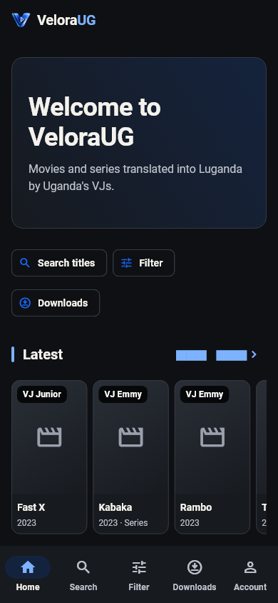
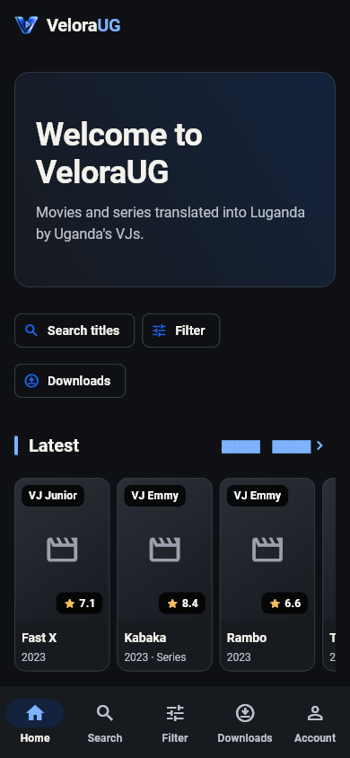
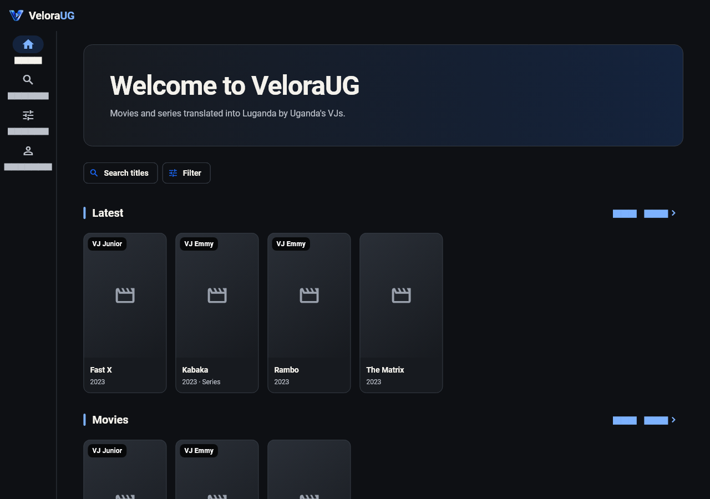
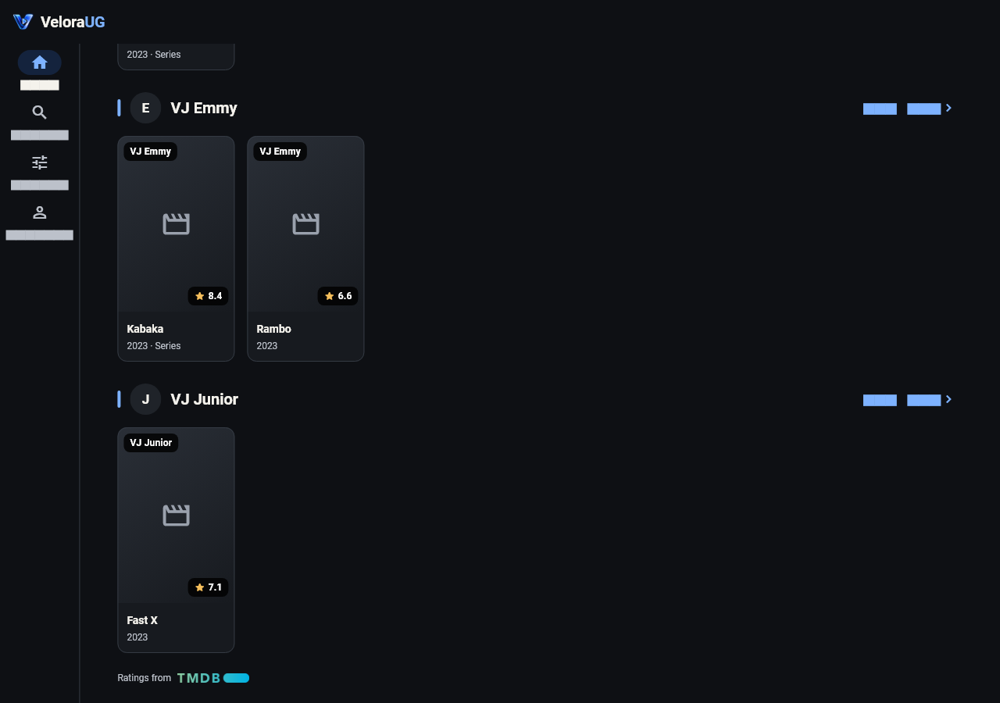
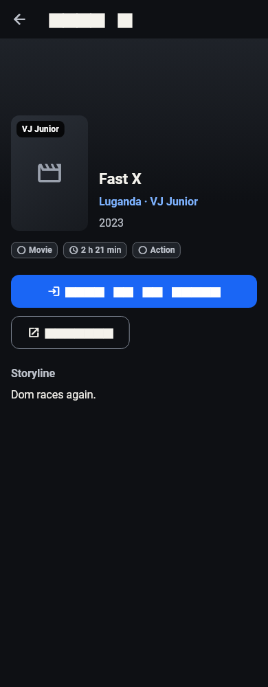
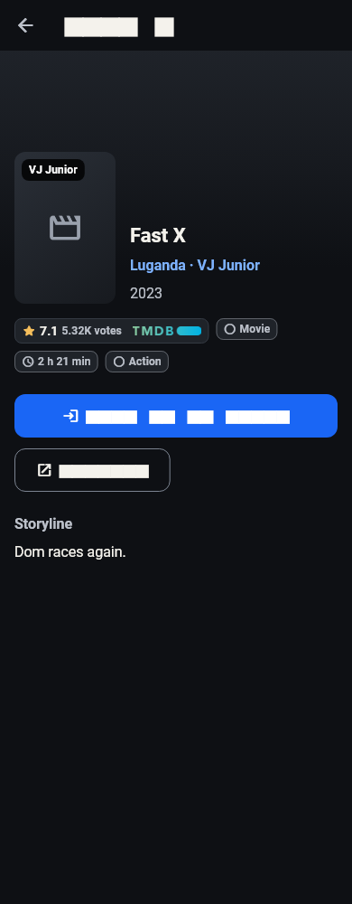

# Step 13A: TMDB ratings

Written and built on 25 November 2026, as Phase 1 of the UI upgrade. **Not yet checked against real TMDB data or in a browser.** The screenshots come from widget tests, not a running app.

## What viewers get

- **On posters,** TMDB's score for the film or series appears in the **bottom-right corner**: a star and one decimal, such as ★ 7.4, on the same dark chip as the VJ's name in the top-left corner. Screen readers hear it with the title: "Fast X, VJ Junior, Rated 7.4 out of 10 on TMDB, 2023".
- **On an edition's page,** the rating is the first badge: the star, the score, the vote count ("5.32K votes") and TMDB's logo.
- **Home, Browse, Search and a VJ's page** end with one small line, "Ratings from", and TMDB's logo. It appears only when something on the screen has a rating.
- **No rating, no badge.** A title that TMDB hasn't rated, that has fewer than 10 votes, or whose details were typed in by an admin shows no badge at all. It never shows a zero or a dash.

The rating is TMDB's audience score for the **source film or series**, not for the VJ's translation. That's why the screen reader and the page credit both say "TMDB".

## Screenshots

These are rendered by widget tests on the fake catalogue. Posters show the neutral placeholder because tests can't load images from the network. **A few labels show as white blocks** (button labels, the app bar title, some navigation labels): the test renderer has no font for them. This is a limit of the screenshots, not a fault in the app.

| | Before | After |
| --- | --- | --- |
| Home, phone (390 px) |  |  |
| Home, wide (1280 px), scrolled to the foot |  |  |
| A movie's page, phone |  |  |

The "before" images are the same screens with no ratings in the data, which is how the app looked before this step. Nothing else on those screens changed.

## How it works

| Part | What changed |
| --- | --- |
| `app/tmdb.py` | `parse_movie` and `parse_series` read `vote_average` and `vote_count` into `MovieDetails.rating` (rounded to one decimal) and `vote_count`. If there are no votes, or a value is missing, not a number, or outside 0 to 10, both are `None`. TMDB sends 0.0 for unrated titles, and that is not a score |
| Migration `0011` | Adds `tmdb_rating numeric(3,1)`, `tmdb_vote_count integer` and `rating_updated_at timestamptz` to `public.sources`, with checks: the rating is between 0 and 10, the votes are at least 0, and the two are either both set or both empty. It also grants `veloraug_app` UPDATE on the three columns, which the API's background refresh needs |
| `save_details` (`app/catalogue.py`) | Writes the rating with the rest of the TMDB copy and dates it. The API's background refresh (every copy older than 7 days) and `scripts/catalogue.py refresh` both use this function, so both now keep ratings fresh |
| `use_source` (`app/admin_catalogue.py`) | Saves the rating when an admin matches an edition to TMDB |
| `expire_copy`, `purge_tmdb` (`scripts/catalogue.py`) | Clear the rating along with the rest of the copy. It is TMDB data, so the 180-day limit applies |
| `app/viewer.py` | Every edition summary (lists, VJ pages, history, watch list) carries the rating, **only from `MIN_VOTES` = 10 votes** |
| API responses | `rating` on every edition card. `rating` and `vote_count` on an edition's page. Both are `null` when there is nothing to show. The TMDB ID is still never sent |
| `scripts/backfill_ratings.py` | Fills in ratings for sources fetched before this step. See [Backfill](#backfill) |
| App | `EditionCard.rating` and `EditionDetail.voteCount`. Strange values are dropped, not refused, so a bad rating can't hide a title. New widgets: `RatingBadge`, `PosterRating`, `TmdbAttribution` and `TmdbLogo`. `MovieCard` gained `bottomCorner` and `bottomCornerLabel`. The VJ chip became a shared `PosterChip` |
| Design tokens | New `rating` colour, `#F5BE5B`, in `tokens.dart`, `tokens.css` and `design-system.md`. It has the same value as `warning` but is a separate token, because a rating isn't a status |

### Decisions

| # | Decision | Why |
| --- | --- | --- |
| 1 | Ratings belong to `sources`, not editions | A rating describes the film, which several VJ editions can share |
| 2 | Show a rating only from 10 votes | Small and regional films often have 1–3 votes, which gives misleading 10.0 scores. The rating is still stored, so `MIN_VOTES` in `app/viewer.py` is a one-line change |
| 3 | The poster rating sits **bottom-right**, not top-right | The owner asked for it on the right. In top-right on a phone rail, it squeezed the VJ's name to "V…". Bottom-right keeps the VJ's name whole on every width. At large text sizes on very narrow cards, the rating shrinks to fit rather than overflowing |
| 4 | One "Ratings from TMDB" line per screen, plus the logo on the page badge | TMDB's terms ask for attribution where its data appears. A logo on every poster would be noise |
| 5 | `rating_updated_at` in addition to `fetched_at` | It records that TMDB was asked, even when it had no rating, so the backfill doesn't ask again |

## Backfill

Sources fetched before this step have no rating until their next refresh. Today that happens within 7 days, as the background refresh reaches them. To fill them in at once, run these as the owner, from `services/api`, **after migration 0011**:

```powershell
.\.venv\Scripts\python.exe scripts\backfill_ratings.py --dry-run
.\.venv\Scripts\python.exe scripts\backfill_ratings.py
```

- By default it fetches every TMDB source whose rating has never been asked for, whatever the age of its copy.
- `--refresh` also fetches sources whose rating is more than 7 days old. Anything asked for within the last 7 days is always skipped.
- It makes 4 requests a second by default (`--rate`, up to 20), waits when TMDB answers 429 with a `Retry-After` of up to 60 seconds, and tries each title 3 times.
- It stops at a refused token. Each title is committed as soon as it is saved, so stopping part-way loses nothing.
- It connects and reads the token the way `scripts/catalogue.py` does, and never prints either.

## How to test it

1. Run migration `0011` on a test branch: `alembic upgrade head`.
2. Match a draft to a well-known film in the admin screens and publish it. Its page should show the star, the score, the vote count and TMDB's logo, and Home should end with "Ratings from TMDB".
3. Publish an edition with typed-in details. It should show no rating badge anywhere, and if nothing else on the screen is rated, no TMDB line either.
4. Run the backfill with `--dry-run`, then without.

## Checks done

- API: 693 passed, 1 skipped, on a local Postgres 17. New tests:
  - parsing in `test_tmdb.py`: rounding, 0 votes, and missing, string, boolean, NaN and out-of-range values
  - in `test_catalogue.py`: saving, clearing at 180 days and on purge, the database checks, and the API role's grant
  - in `test_catalogue_api.py`: the responses, the 10-vote minimum and the background refresh
  - all of `test_backfill_ratings.py`: which sources are chosen, pacing, `Retry-After` and its 60-second cap, failures and a refused token
- `ruff format --check` and `ruff check` are clean.
- App: 521 tests pass and `flutter analyze` is clean. New tests:
  - all of `test/rating_badge_test.dart`: the badge, the poster corners, and fitting a 96-pixel card at text sizes 1 and 2 without overflow or overlap
  - parsing in `test/api/catalogue_api_test.dart`
  - Home and an edition's page, rated and unrated, in `test/viewer_screens_test.dart`
  - the new token's contrast and its CSS mirror in `test/theme_tokens_test.dart`
- Sign-in pages: 22 tests pass (`tokens.css` gained one variable and nothing else).

## Deploying

Run migration `0011` **before** deploying the API, because the API now reads the new columns. The API must also be deployed before the app, but the app accepts answers without `rating`, so an older API does no harm. `scripts/copy_to_production.py` refuses databases at different migrations, as before.

## Follow-ups

- The VJ chip (`PosterChip`) still uses the raw near-black `Colors.black` at 82% and `Colors.white` that `CornerLabel` always had. Phase 6 could turn them into tokens.
- History and Watch list rows use plain posters, not `MovieCard`, so they show no rating. Phase 6 can decide whether they should.
- Phase 2's hero carousel can use `rating` from the cards as it is.
- The vote count uses `intl`'s short form, which keeps three significant figures ("1.23K votes", "123K votes").
