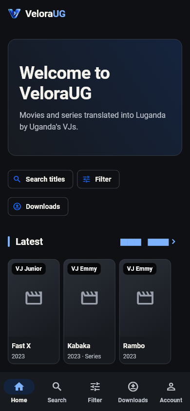
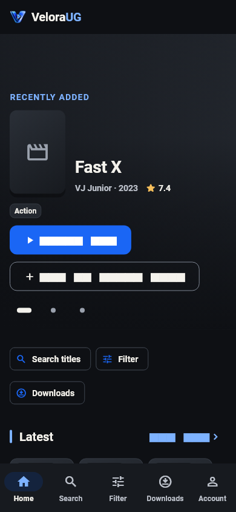
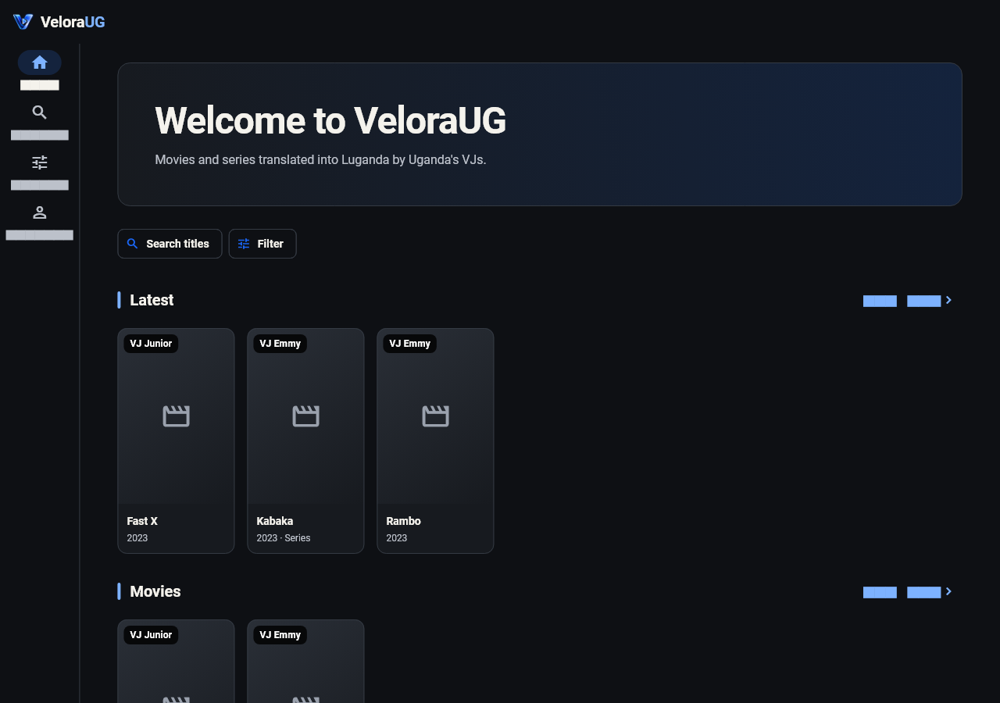
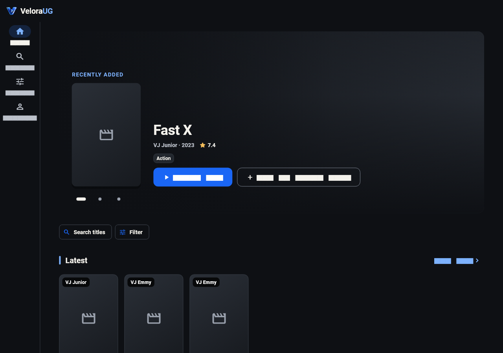

# Step 13B: Home's "Recently added" hero

Written and built on 25 November 2026, as Phase 2 of the UI upgrade. Built on Step 13A (TMDB ratings), because the hero shows ratings. **Not yet checked in a browser, on a phone, or with real artwork.** The screenshots come from widget tests.

## What viewers get

The top of Home is now the three newest titles, shown one at a time over their artwork. It replaces the "Welcome to VeloraUG" panel whenever there is something to feature.

- **Each title** shows its backdrop, behind a dark gradient so the words read over any image. A title without a backdrop shows its poster, blurred and enlarged. Over the artwork are the poster card, the title, the VJ and year, TMDB's rating, up to three genres, and two buttons.
- **Watch now**:
  - **A movie, signed in:** it plays through exactly the player the movie's page uses, which asks for a grant and so checks the pass and the device. Nothing is skipped.
  - **Signed out:** the button reads **Sign in to watch** and starts sign-in, as on the movie's page.
  - **A series:** it opens the series page to choose an episode.
- **Second button**:
  - **A movie:** **Add to Watch List**. It changes to **✓ In Watch List** at once, then saves. If saving fails, it changes back and a message says why. Signed out, it starts sign-in.
  - **A series:** **Details**, because the Watch List saves episodes one at a time, on the series page.
  - **The poster:** tapping it also opens the title's page.
- **Moving on:** every 6 seconds, with a 0.6-second crossfade, while the artwork slowly zooms 6% and the poster rises into place.
  - **Stops:** while the pointer is over it, while it is touched, while a button in it has keyboard focus, while the app is in the background or another screen covers Home, and when the viewer presses **Pause**.
  - **Dots:** one per title. The current one fills as its time passes. Each dot is a 48-pixel button, read as "Show title 2 of 3" and as selected.
  - **Other ways to move:** swiping, and the left and right arrow keys while the hero has focus.
- **Reduced motion:** with the system's setting on, the hero never moves on by itself and doesn't zoom or fade. The dots, swiping and the arrow keys still change the title, at once, and there is no Pause button because nothing moves.
- **States**:
  - **Loading:** a placeholder with the hero's shape.
  - **No titles to feature, or the request failed:** the welcome panel, as before.
  - **The rest of Home:** loads and fails on its own, unchanged.
- **Sizes**:
  - **Phones:** the hero runs edge to edge, 4:5, with a small poster beside the title.
  - **600 pixels and wider:** it fills the content width (up to 1280 pixels), 21:9 and between 420 and 560 pixels tall, with rounded corners and a 176-pixel poster.
  - **Large text:** the hero grows taller rather than cutting anything off.

## Screenshots

These are rendered by widget tests with the test catalogue. **The artwork is a plain gradient and the posters are placeholders**, because tests can't load images from the network. **A few labels show as white blocks**: the test renderer has no font for them. With real data, the backdrop fills the hero.

| | Before | After |
| --- | --- | --- |
| Home, phone (390 px) |  |  |
| Home, wide (1280 px) |  |  |

## How it works

| Part | What changed |
| --- | --- |
| `GET /api/v1/featured` | The three newest published titles that have something to watch. Test films, and titles whose TMDB copy is too old to show, are left out. Each title has the card's fields (title, year, poster, VJ, rating from 10 votes), plus `genres`, `backdrop_url` and, for a movie, `item_id`. Needs no sign-in. Like the edition list, it may start the background TMDB refresh |
| `app/viewer.py` `list_featured` | One query: newest `published_at` first, where an approved item has a ready original. The API's role can only see those, so the `exists()` means "playable" |
| `ImageConfig.hero_backdrop_size` | `w1280` (or the closest wider size TMDB offers). The edition page keeps `w780` |
| `lib/widgets/hero_carousel.dart` | `HeroCarousel` and `HeroCarouselSkeleton`. Moving on is driven by an `AnimationController`, so it stops with the app's frames. `TickerMode` and `AppLifecycleListener` stop it when Home is covered or the app leaves the foreground. All six images are loaded ahead of time |
| `lib/widgets/screen_body.dart` | A `banner` slot that replaces the heading and intro. It runs edge to edge on a phone. Every other screen is unchanged |
| `lib/screens/home_screen.dart` | Loads the hero beside the first three shelves, on its own. The TMDB credit at the foot of Home now counts the hero's ratings too |
| `lib/screens/edition_screen.dart` | `_CanWatch` and `_canWatch` are renamed to the public `WatchAccess` and `watchAccess`, so the hero asks the same question as the edition page. Their behaviour is unchanged |
| Tokens | `VeloraMotion.heroInterval` (6000 ms), `heroCrossfade` (600 ms) and `heroZoom` (1.06), mirrored in `tokens.css`. `VeloraLayout.heroAspectCompact` (4:5), `heroAspectWide` (21:9), `heroMinHeight` (420) and `heroMaxHeight` (560). All are in `design-system.md`, which also describes how the hero moves and when it stops |

### Decisions

| # | Decision | Why |
| --- | --- | --- |
| 1 | A series' **Watch now** opens its page, and its second button is **Details** | The owner's choice. The Watch List saves episodes, not whole series |
| 2 | Only titles that can be watched, and no test films | The owner's choice. **Watch now** always leads somewhere |
| 3 | The hero replaces the welcome panel when there is something to feature | The owner's choice |
| 4 | The button says **Watch List**, not "My List" | The app already calls it the Watch List, on the movie page and in Account. One name for one list |
| 5 | A visible **Pause** button | WCAG 2.2.2: anything that moves by itself for more than 5 seconds needs a way to stop it |
| 6 | With reduced motion, no moving on by itself | "Calm and pausable" in the design system. The viewer chooses each title |
| 7 | Keyboard focus returns to the hero when a title change removes the focused button | Otherwise the arrow keys stop working after one press, and the hero starts moving again under the keyboard |

## How to test it

1. Publish at least two titles with a ready video, one a movie and one a series. Open Home on a phone and in a desktop browser.
2. Watch the hero move on every 6 seconds. Hover over it, touch and hold it, tab into its buttons and press Pause: each should stop it.
3. Turn on the system's reduced motion setting (Android: *Remove animations*; Windows: *Animation effects* off). The hero should stay on the first title, with no zoom, until a dot is chosen.
4. Signed out, **Sign in to watch** should start sign-in. Signed in without a pass, **Watch now** on a movie should end at the same pass prompt as the movie's page. With a pass, the movie should play.
5. **Add to Watch List** on a movie should show ✓ at once, and the movie should appear in Account → Watch List.

## Checks done

- API: 704 passed, 1 skipped, on a local Postgres 17. New tests in `tests/test_viewer.py` cover the order, the fields, at most three, leaving out what can't be watched, an expired TMDB copy, the 10-vote rule and an empty catalogue. `tests/test_tmdb.py` covers the hero backdrop size. `ruff format --check` and `ruff check` are clean.
- App: 552 tests pass, and `flutter analyze` is clean. `test/hero_carousel_test.dart` (29 tests) covers:
  - the hero replacing the welcome panel
  - the empty, failed and loading states
  - moving on every 6 seconds and wrapping around
  - the zoom
  - stopping under the mouse, under a finger, with keyboard focus, in the background, and with Pause and Play
  - reduced motion
  - the dots and their semantics, swiping, and the arrow keys
  - each **Watch now** path
  - the Watch List: saving at once, a movie already saved, putting it back on failure, and signed out
  - fitting 320, 768 and 1280 pixels at text sizes 1 and 2
  - parsing in `test/api/catalogue_api_test.dart`, and the new tokens in `test/theme_tokens_test.dart`
- Sign-in pages: 22 tests pass (`tokens.css` gained three variables).

## Fixed in Step 13A along the way

- At 320 pixels with text at twice the size, the "Ratings from TMDB" line overflowed by 8 pixels. The words now wrap. This is pushed to PR #13 with a test.

## Deploying

Deploy the API before the app: the app asks for `/api/v1/featured`. The hero is optional, so an older API only means the welcome panel stays. There is no migration in this step.

## Follow-ups

- Phase 4 adds categories. The hero should show them beside the genres then.
- With real artwork, check that the gradient keeps the words readable over very bright backdrops. The tokens allow a darker gradient if needed.
- The hero's VJ name isn't a link. Phase 3's rails, or Phase 6, could make it open the VJ's page.
