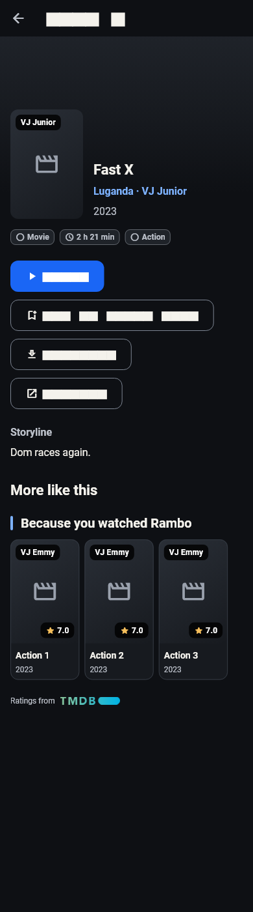
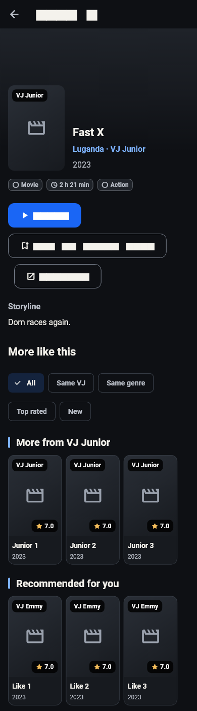
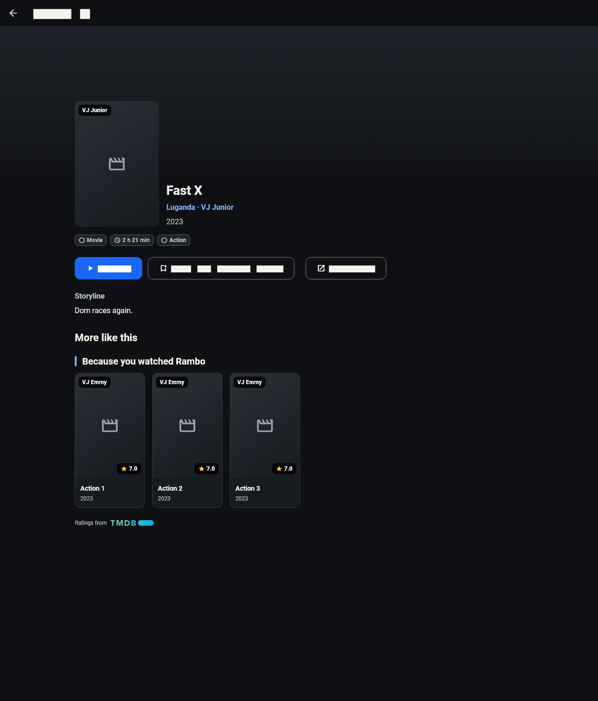
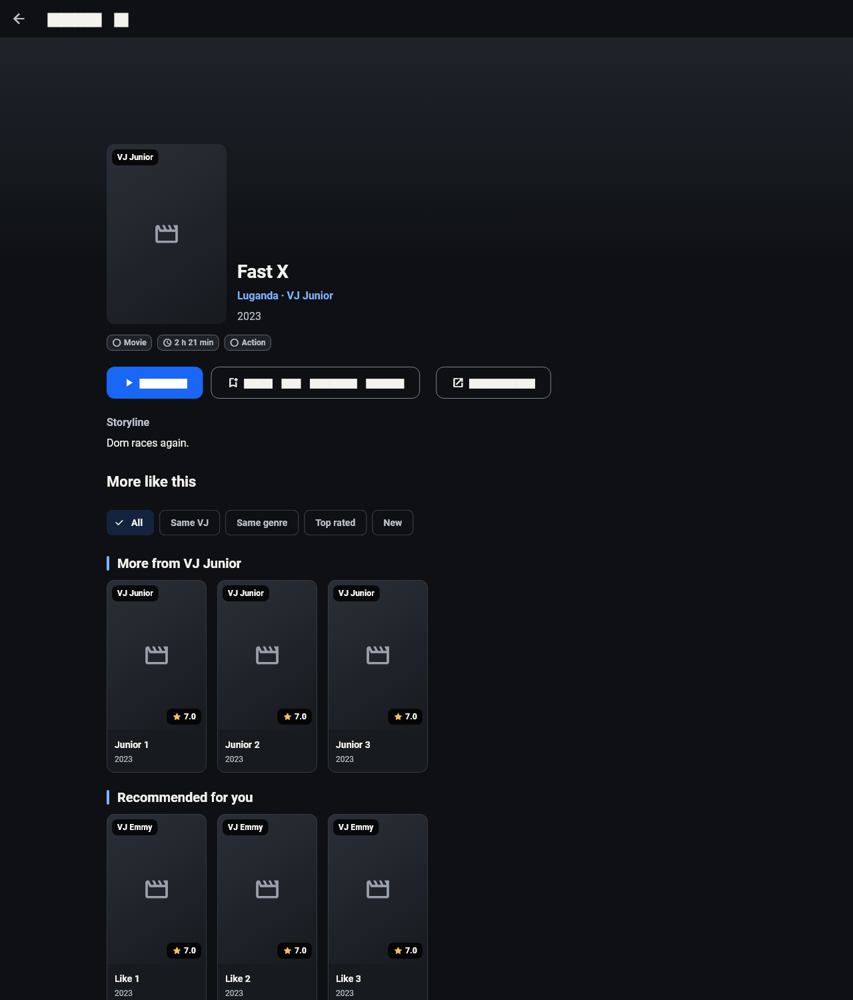

# Step 13C: Discovery rails on movie and series pages

Written and built on 25 November 2026, as Phase 3 of the UI upgrade. Built on Step 13B, which is built on Step 13A. **Not yet checked against a real catalogue, in a browser, or on a phone.** The screenshots come from widget tests.

## What viewers get

Below everything about a title, under **More like this**, there are shelves of other titles from VeloraUG's own catalogue. They use the same posters, VJ labels and ratings as Home's shelves.

| Movie page | Series page |
| --- | --- |
| More from VJ Junior | More from VJ Emmy |
| Recommended for you | Recommended series |
| Because you watched Rambo (signed in) | Because you watched … (signed in) |
| Most popular | Trending series |
| Top rated | Top rated |
| Recently added | New episodes this week |

- **Only rails with at least 3 titles appear**, at most 12 titles each. No rail shows the title itself, another VJ's version of the same film, or a test film.
- **The chips** above the rails choose which rails show. A chip whose rails didn't qualify isn't offered, and with only one rail there are no chips at all.
  - **All:** every rail.
  - **Same VJ:** More from this VJ.
  - **Same genre:** Recommended, plus Because you watched.
  - **Top rated:** the Top rated rail.
  - **New:** Recently added, or New episodes for a series.
- **Because you watched** appears only when signed in. It uses the title the viewer played most recently, other than this one.
- **States:**
  - **Loading:** rail-shaped placeholders show while the rails load. The rest of the page never waits for them.
  - **Failed:** "Couldn't load more titles", with **Try again**.
  - **Nothing qualifies:** the whole section is left out.
- **TMDB credit:** the section ends with the "Ratings from TMDB" line, as on Home.

## How the rails are ranked

Everything is ranked in SQL, in `app/discovery.py`. Every rail first keeps only published titles of the same kind (movie or series) that can be shown, then leaves out the title, other VJs' editions of the same source film, and test films.

| Rail | Order | Kept only if |
| --- | --- | --- |
| More from this VJ | Newest first | Same VJ |
| Recommended | **Score**, then newest | At least one shared genre |
| Because you watched X | Recommended's score, measured against X | X is the viewer's most recently played title other than this one. Leaves out this title, X and both their source films |
| Most popular, Trending series | Viewers in the last 30 days, then TMDB popularity, then newest | |
| Top rated | TMDB rating, then number of votes | At least 10 votes |
| Recently added | Newest first | Movies |
| New episodes this week | Newest approved episode first | Series with an episode approved in the last 7 days |

**Recommended's score** is:

- **3** for each genre the title shares with this one
- **+1** if it's by the same VJ
- **+ TMDB rating ÷ 10**, worth up to 1, and only from 10 votes
- **+0.5** if it was published in the last 30 days

Shared genres dominate: one shared genre (3) always beats a same-VJ title with a top rating and no shared genre, which isn't eligible anyway. Between titles sharing the same number of genres, the VJ, the rating and how new it is decide the order.

**Viewers** are people who played some of a title, with a saved position, in the last 30 days. A playback grant alone, with nothing played, doesn't count. Each viewer's history is private: the API's database role can only see the signed-in viewer's own rows. So the counting is done by `public.edition_viewers(days)`, a database function that runs as the migration's owner and returns **only `(edition_id, viewers)`, never who watched**. Only the API's role may call it. Titles nobody has watched yet are ordered by TMDB's popularity.

### Indexes (migration 0012)

| Index | For |
| --- | --- |
| `sources_genres_idx`, GIN on `genres` | Recommended's `genres && …` filter |
| `editions_vj_published_idx`, on `(vj_id, kind, published_at desc)` for published editions | More from this VJ |
| `watch_history_item_idx`, on `(item_id, last_watched_at)` | Counting viewers per title over the last 30 days |
| `items_edition_approved_idx`, on `(edition_id, approved_at)` | New episodes this week |

## Screenshots

These are rendered by widget tests with test titles. Tests can't load network images, so posters are placeholders. The white blocks are labels the test renderer has no font for.

| | Before | After |
| --- | --- | --- |
| A movie's page, phone |  |  |
| A movie's page, wide |  |  |

## What changed

| Part | Change |
| --- | --- |
| Migration `0012` | `sources.tmdb_popularity` (the API's role may update it). Lets the API's role read `items.approved_at`. Adds `public.edition_viewers(days)`, executable by `veloraug_app` only. Adds the four indexes above |
| `app/tmdb.py`, `catalogue.py`, `admin_catalogue.py` | TMDB's `popularity` is parsed, saved on matching and every refresh, and dropped if it's strange |
| `scripts/catalogue.py` | Clears `tmdb_popularity` along with the rest of the TMDB copy at 180 days and on purge |
| `app/discovery.py` | The rails and Because you watched |
| `GET /api/v1/editions/{id}/rails` | `{rails: [{key, editions}]}`, only rails with 3 or more titles, in page order. 404 for an edition that isn't published. Needs no sign-in |
| `GET /api/v1/me/because-you-watched/{id}` | `{watched_id, watched_title, editions}`, or `null`. Signed in only. Reads the viewer's own history |
| `lib/widgets/discovery_rails.dart` | `DiscoveryRails` and `RailSkeleton`. Uses the existing `EditionRow` shelf, `ChoiceChip`s styled like Filter's, `ErrorState` and `TmdbAttribution` |
| `lib/screens/edition_screen.dart` | The rails sit below the details and episodes, in the same 960-pixel column so the left edges line up |
| `lib/api/catalogue_api.dart`, `account_api.dart` | `EditionRail`, `rails()`, `BecauseYouWatched` and `becauseYouWatched()` |
| Strings | The rail names, the chips, the heading and the error, all in `app_en.arb` |

### Decisions

| # | Decision | Why |
| --- | --- | --- |
| 1 | Most popular counts our own viewers, with TMDB popularity as the fallback | The owner's choice. It reflects what VeloraUG's viewers actually watch |
| 2 | The chips choose which rails show | The owner's choice |
| 3 | Other VJs' versions of the same film are left out of every rail | The owner's choice. A separate "Also translated by" rail can follow |
| 4 | Because you watched takes the edition in the path, not `?edition=` | The app's signed-in requests go through one helper that sets only the path |
| 5 | Rails aren't de-duplicated against each other | A title can be both popular and top rated. With a small catalogue, de-duplicating would empty rails |
| 6 | Rails load once the page has shown, not when scrolled into view | No new dependency is needed. It's one request and never delays the page |

## How to test it

1. Run migration `0012` on a test branch: `alembic upgrade head`. To fill in TMDB popularity for existing titles, run `scripts/backfill_ratings.py --refresh`. It now saves popularity too, since it saves the whole copy.
2. Open a movie with at least three other movies sharing a genre. You should see Recommended. Choose each chip.
3. Signed in, play part of another title, then open a third. **Because you watched** should name the one you played.
4. Approve a new episode of a series. On another series' page, **New episodes this week** should list it first.

## Checks done

- **API:** 731 passed, 1 skipped, on a local Postgres 17, with `ruff` clean. `tests/test_discovery.py` (18 tests) covers:
  - the rail order
  - each rail's ranking, including the recency bonus and the 10-vote rule
  - what's left out, and rails with fewer than 3 titles
  - viewers versus TMDB popularity, including old views and grants with nothing played
  - New episodes this week
  - 404 for a draft or unknown title
  - that `edition_viewers` returns counts but not users, and that only the API's role may call it
  - that the API's role still can't read other viewers' history
  - Because you watched: for the viewer, without history, with another viewer's history, and signed out
  - Popularity parsing in `test_tmdb.py`, and saving and clearing it in `test_catalogue.py`
- **App:** 571 tests pass and `flutter analyze` is clean. `test/discovery_rails_test.dart` (16 tests) covers:
  - the movie and series rail sets and their names
  - fewer than 3 titles, each chip, All, and a single rail without chips
  - Because you watched signed in and signed out
  - loading, failure with Try again, and no rails
  - 320 pixels at text sizes 1 and 2
  - Parsing in `test/api/catalogue_api_test.dart`

## Deploying

Run migration `0012` before deploying the API. Then deploy the API before the app: an older API answers 404 for the rails, which the app shows as "Couldn't load more titles".

## Follow-ups

- Phase 4's categories should join Recommended's score next to genres, perhaps at 2 points each.
- An "Also translated by" rail for other VJs' versions of the same film.
- `edition_viewers` counts on every page view. Past a few thousand titles or viewers, cache it for a few minutes or keep it in a materialized view refreshed by a schedule.
