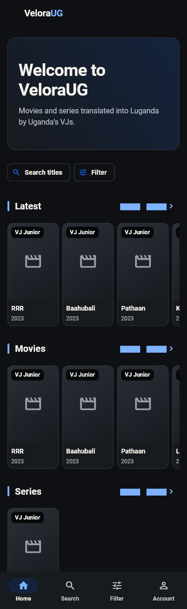
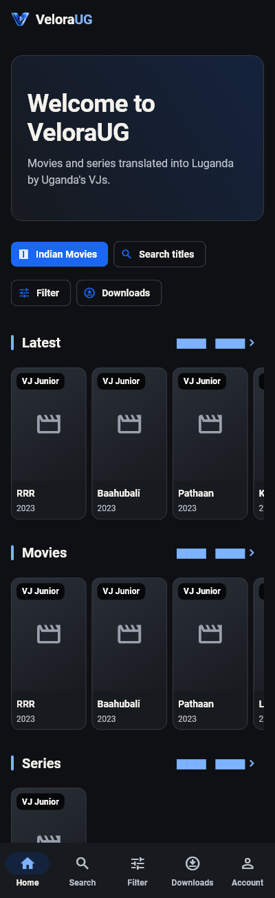
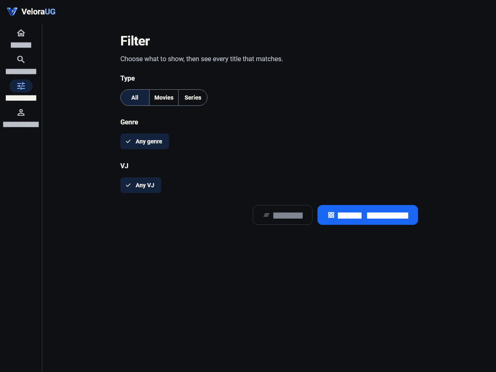
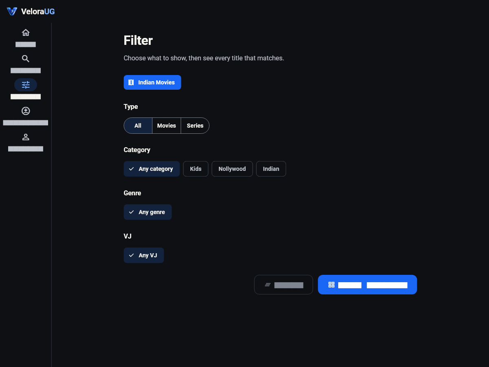
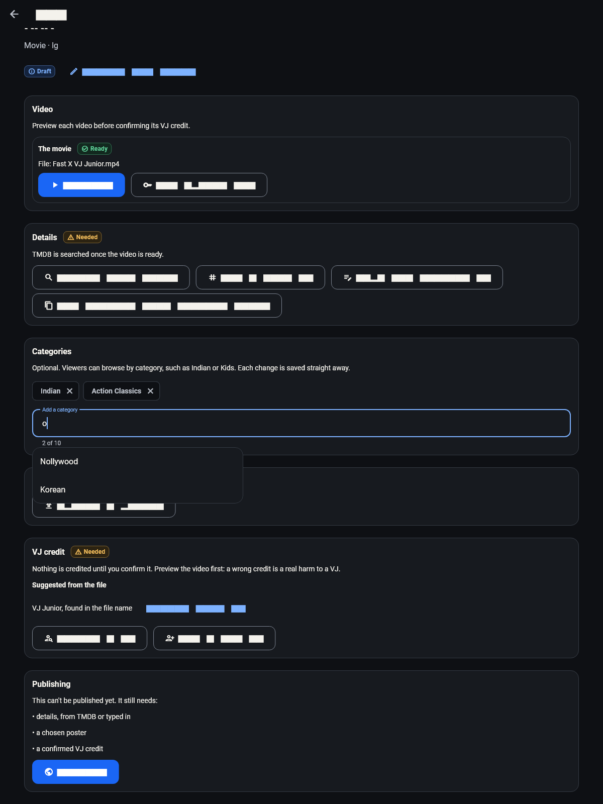

# Step 13D: Categories and the Indian Movies chip

Written and built on 25 November 2026, as Phase 4 of the UI upgrade. Built on Step 13C, which is built on 13B and 13A. **Not yet checked against a real catalogue, in a browser, or on a phone.** The screenshots come from widget tests.

## What admins get

On each title's admin page there's a new optional **Categories** section, between Details and Poster.

- **Adding:** type a name, then press **Enter** or type a **comma**. A comma list such as `Kids, Korean,` adds each name.
- **Suggestions:** while typing, known categories that match show below the field, the most used first. Tap one to add it.
- **One spelling:** a name matching a known category, whatever its case, takes that category's spelling, so `indian` adds **Indian**.
- **Removing:** each chip's **×** removes it, and **Backspace** in the empty field removes the last one.
- **Limits:** at most **10 categories** per title and **40 characters** per name. The field says "3 of 10", explains a name that's too long, and switches off at 10 with the reason.
- **Saving:** each change is saved straight away, like the rest of the page, with "Categories saved". A refusal from the server is shown, and the chips stay as they were.
- **Not required:** categories never block publishing.

The seeded categories are **Indian, Nollywood, Korean, Chinese, Action Classics and Kids**. Typing any other name adds it as a new category.

## What viewers get

- **Indian Movies chip:**
  - shown first on Home, before Search titles, and at the top of Filter
  - filled in the accent colour, so it stands out from the other quick links
  - opens the Indian movies, newest first, a page at a time
  - hidden while there are no published Indian movies, so it never leads to an empty page
- **Home rows:** one row per category with published titles, after Movies and Series and before the genre rows. **Indian** comes first, then the most used, up to 6 rows. See all opens the whole category.
- **Filter:** a **Category** section between Type and Genre, combining with the other choices. While no category has titles, the section is left out, as Language is with only one language.
- **States:**
  - **Loading:** Filter shows chip-shaped placeholders while the categories load.
  - **Failed:** Filter says "Couldn't load Category choices" with **Try again**. On Home the chip and rows are left out, and nothing else waits.

## Decisions

| # | Decision | Why |
| --- | --- | --- |
| 1 | A lookup table (`categories` plus `edition_categories`), not a text array with a GIN index | Seeds and autocomplete need categories before any title has them. One row per category gives one spelling, and a later rename is one row. Filtering and Home's rows look categories up by their link rows, which a plain b-tree index on `(category_id, edition_id)` serves. A GIN index is for "which titles contain this value" across an array column, which a link table doesn't need |
| 2 | Categories belong to each VJ's edition, not the source film | The film's details are TMDB's copy and are cleared after 180 days. Categories are VeloraUG's own. The catch: two VJs' versions of the same film are tagged separately |
| 3 | Matching ignores case; the first spelling saved wins | So "Indian" and "INDIAN" never become two categories. Names are trimmed with single spaces. Commas are refused, since a comma separates names in the field |
| 4 | Indian Movies means the category with the address `indian`, movies only | The brief says Indian **Movies**. The Home row and Filter's Indian choice include series too |
| 5 | Home's category rows come before the genre rows, Indian first, at most 6 | The owner approved this in the plan |
| 6 | Categories don't join "More like this" scoring yet | It would change Phase 3's ranking. Left as a follow-up |
| 7 | The title page doesn't list its categories | The plan mentioned the edition's detail carrying categories, but nothing on the page would show them yet, so I left the field out rather than add unused data |

## What changed

| Part | Change |
| --- | --- |
| Migration `0013` | `categories` (name 1–40 characters, trimmed, unique whatever its case; slug unique), `edition_categories` (edition, category, when added), the index on `(category_id, edition_id)`, a trigger refusing an 11th category, and the six seeds. Row-level security: the API's role reads only categories and links of published editions; the editor role may read, add and change |
| `app/admin_catalogue.py` | `normalise_category`, `category_slug`, `list_categories`, `edition_categories` and `set_categories`, which locks the edition, makes new names, and keeps the given order |
| `app/admin.py` | `GET /api/v1/admin/categories`, `PUT /api/v1/admin/editions/{id}/categories` with `{names: [...]}`, and `categories` on the admin edition |
| `app/viewer.py`, `viewer_routes.py` | `GET /api/v1/categories` (`slug`, `name`, `editions`, `movies`), only categories with published, showable, non-test titles. `/api/v1/editions?category=<slug>` |
| `scripts/copy_to_production.py` | Copies a title's categories, matched on production **by name**, since production's seeds have their own IDs. A category production hasn't got is added. A clash of addresses stops the copy with a message |
| `scripts/check_database.py` | Checks the two new tables have forced row-level security and that the API's role may only read them |
| `lib/admin/category_input.dart` | The chip input |
| `lib/admin/draft_screen.dart` | The Categories section. The suggestions load on their own, so the page still works if they fail |
| `lib/screens/home_screen.dart` | The Indian Movies chip and the category rows. Categories load alongside the hero |
| `lib/screens/filter_screen.dart` | The Indian Movies chip, `IndianMoviesChip`, `openIndianMovies` and the Category section |
| `lib/screens/browse_screen.dart`, `lib/api/*.dart` | `BrowseFilter.category`, `Category`, `categories()`, `AdminCategory` and `setCategories()` |
| `lib/widgets/velora_text_field.dart` | The field error (an icon and words) is now public, as `VeloraFieldError`, so the chip input shows errors the same way |
| Strings | All in `app_en.arb` |

No design tokens changed. The chips are Flutter's own `InputChip`, `ChoiceChip` and `ActionChip` under the app's theme, and the Indian Movies chip uses the theme's accent fill.

## Screenshots

Rendered by widget tests with test titles. Tests can't load network images, so posters are placeholders. The white blocks are labels the test renderer has no font for. "Before" is the same screen with no categories, which is how it looked before this change.

| | Before | After |
| --- | --- | --- |
| Home, phone |  |  |
| Filter, wide |  |  |
| Admin: a title's Categories, with suggestions for "o" | |  |

## How to test it

1. Run migration `0013` on a test branch: `alembic upgrade head`. The six seeds appear in `public.categories`.
2. In Admin, open a published movie, type `indian` and press Enter. The chip says **Indian**.
3. On Home, **Indian Movies** appears first in the quick links, with an **Indian** row after Series. Tap the chip: only Indian movies are listed.
4. In Filter, choose a category with Series, then **Show results**.
5. Try 11 categories, a 41-character name and a comma inside a name. Each is refused with a reason.

## Checks done

- **API:** 757 passed, 1 skipped, on a local Postgres 17, with `ruff` clean. `tests/test_categories.py` covers:
  - trimming, spaces, the 40-character limit, commas and empty names, and addresses
  - the seeds
  - matching whatever the case, keeping the order, replacing, and removing all
  - 10 allowed, an 11th refused by the API and by the database trigger, with nothing changed after a refusal
  - a name differing only in punctuation getting its own address
  - 404 for an unknown title, and 403 for someone who isn't an admin
  - viewers' list: only published, showable, non-test titles, with movie counts
  - filtering, alone and with the type
  - the API's role seeing only published links, and being unable to change categories
  - `test_copy_to_production.py`: categories copied by name, reusing production's seed
- **App:** 600 tests pass and `flutter analyze` is clean.
  - `test/category_input_test.dart` (15 tests): Enter, commas, the catalogue's spelling, repeats, suggestions, ×, Backspace, the 40 and 10 limits, 320 pixels at text sizes 1 and 2, and on the draft screen saving, working without suggestions, and showing a refusal
  - `test/categories_test.dart` (12 tests): the chip on Home and Filter, hidden without Indian movies or when categories fail, Home's rows and their order and limit, See all, Filter's section with loading, failure, Try again and none, and 320 pixels at text sizes 1 and 2
  - Parsing in `test/api/catalogue_api_test.dart`
- **Auth pages:** 22 pass.

## Deploying

Run migration `0013` before deploying the API, then the API before the app. An older API answers 404 for `/api/v1/categories`, which the app treats as no categories: no chip and no rows.

Run `copy_to_production.py` only once production is at `0013`; it already refuses databases at different migrations.

## Follow-ups

- Add shared categories to "More like this" scoring, perhaps 2 points each next to 3 per shared genre.
- Renaming, merging and deleting categories in Admin. Today an unused category stays in the suggestions.
- Showing a title's categories on its page, as links to the category.
- A category is per VJ's edition: tagging another VJ's version of the same film could be suggested.
