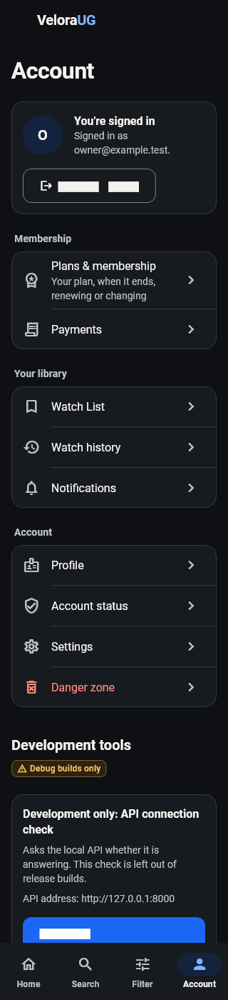
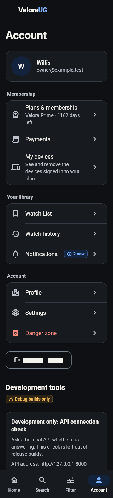
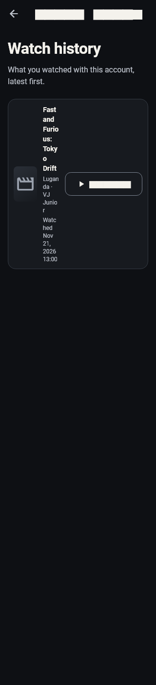
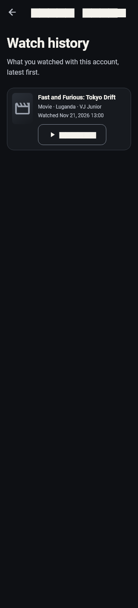
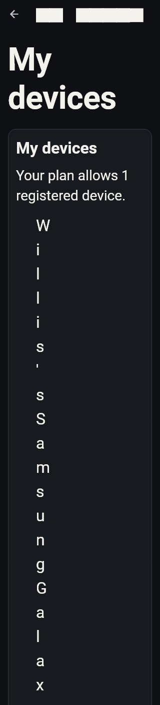
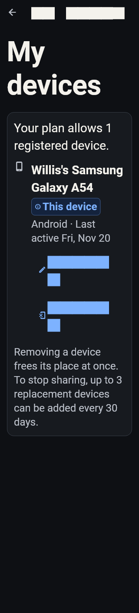
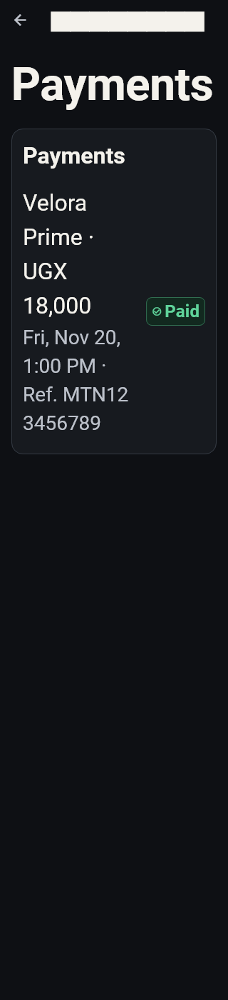
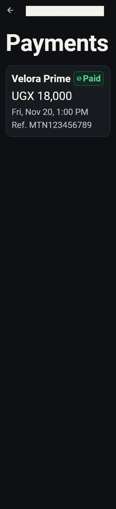

# Step 13E: The Account section

Written and built on 25 November 2026, as Phase 5 of the UI upgrade. Built on Step 13D, which is built on 13C, 13B and 13A. **Not yet checked on a real phone or in a browser.** The screenshots come from widget tests.

Presentation only: no API route, payment, pass, device-limit, playback, download or deletion behaviour changed.

## The audit

The audit was sent to the owner before anything was built, and the owner approved its recommendations. Each Account page was opened in the test renderer on a 320-pixel phone at text sizes 1 and 2. The "before" screenshots are in [`step-13e/audit/`](step-13e/audit/).

| # | Found | Done |
| --- | --- | --- |
| 1 | **Watch history** rows broke on a 320-pixel phone: about 4 letters per line at normal text size, and an overflow at text size 2. Resume took most of the width | Resume sits under the title, beside the poster, so the text has the full width |
| 2 | **My devices**: at text size 2 the device name showed one letter per line, beside Rename and Remove | The name has the full width; Rename and Remove are under it, each with an icon and a label |
| 3 | **Payments**: at text size 2 the plan, price, date and reference wrapped into a narrow column beside the badge | One fact per line: the plan with its badge, then the amount, the date and the reference |
| 4 | Plans, Payments and My devices said their heading twice: the page's, then the card's | The card has no title where the page's heading already names it |
| 5 | Payments and My devices showed a plain line when empty | The shared `EmptyState`, with a line saying what will appear there |
| 6 | Raw sizes for the avatar (56), thumbnails (48, 36) and the unread dot (4), and a colour used directly | New tokens `avatarSize`, `thumbWidth` and `dotSize`; the dot's colour comes from the palette |
| 7 | "Plans & membership" breaks mid-word at text size 2 | Left for Phase 6: it's the shared page heading |
| A | The plan wasn't visible on the hub | The Plans row says "Velora Prime · 24 days left", or "No plan · Choose a plan" |
| B | Unread notifications weren't visible on the hub | The Notifications row shows "2 new" |
| C | My devices was two taps deep, inside Settings | It's under Membership, next to the plan whose limit it follows |
| D | Account status repeated Plans, and its sign-in card stood alone | Its sign-in card (email and whether it's verified) is on Profile; the page and its row are gone |
| E | The card said "You're signed in", and Sign out was the first button on the page | The card shows the display name with the email under it; Sign out is at the foot of the hub |
| F | Watch history didn't say whether a title was a movie or an episode | "Movie · Luganda · VJ Junior", or the episode's name for a series |
| G | Undo after removing from Watch List | **Not built.** It would add the title back, a behaviour change in a presentation-only phase |
| H | Push notifications took three lines to say they aren't available | One line: "Coming soon. Notifications still arrive in your inbox." |

Not proposed, because each needs new API work: removing titles from Watch history, a progress bar on history rows (the API doesn't send running times), and changing the email or password inside the app.

## How the hub gets its glance

The hub reads three things the app already reads elsewhere: the viewer's plan (`GET /api/v1/me/pass`, as Plans does), their notifications (`GET /api/v1/me/notifications`, as the inbox does) and their display name (`GET /api/v1/me`, as Profile does). They load on their own, after the hub shows. One that fails is simply left out: the Plans row keeps its usual help line, Notifications has no count, and the card shows the email. They load again when the viewer comes back from a page, so buying a plan or reading notifications shows straight away.

**One thing to know:** `GET /api/v1/me` creates the viewer's profile row the first time it's called. Until now that happened when they first opened Profile; now it happens when they first open Account. The row holds only an optional display name.

## Screenshots

320 pixels wide, from widget tests with test data. Posters are placeholders and white blocks are labels the test renderer has no font for. The plan in the test ends in 2030, hence "1162 days left".

| | Before | After |
| --- | --- | --- |
| The hub |  |  |
| Watch history |  |  |
| My devices, text size 2 |  |  |
| Payments, text size 2 |  |  |

## What changed

| Part | Change |
| --- | --- |
| `lib/screens/account_screen.dart` | The hub's glance, My devices under Membership, no Account status row, the identity card's name and email, Sign out at the foot |
| `lib/screens/account/account_pages.dart` | `AccountRow.badge`; Plans, Payments and My devices pages without the repeated card title; `SignInCard` on Profile |
| `lib/screens/account/account_status_screen.dart` | Removed |
| `lib/screens/account/history_screen.dart` | The row's new layout, and Movie or the episode's name |
| `lib/screens/account/settings_screen.dart` | My devices moved out; push is one line |
| `lib/screens/account/notifications_screen.dart`, `watch_list_screen.dart` | The dot and thumbnail use tokens and the palette |
| `lib/screens/devices_screen.dart` | The device and payment rows, the empty states, and an optional card title |
| `lib/screens/pass_screen.dart` | `AccountCard`'s title is optional; `MembershipSection(titled:)` |
| `lib/api/account_api.dart` | `displayName()` |
| Tokens | `avatarSize` 56, `thumbWidth` 48 and `dotSize` 8, in `tokens.dart`, `tokens.css` and `design-system.md`, checked by `theme_tokens_test.dart` |
| Strings | New: the no-plan line, "{count} new", the two empty-state lines and the push line. Removed: the 17 strings only Account status and the old push and identity text used |

## Checks done

- **App:** 635 tests pass and `flutter analyze` is clean. `test/account_hub_test.dart` (32 tests) covers:
  - the Plans row with a plan, without one, and when the plan can't load
  - the unread count, and it going after reading
  - the name and email, and the email alone
  - Sign out's place, My devices' place, and Account status gone
  - Profile's sign-in card
  - My devices: one heading, the name above its actions, and the empty state
  - Payments: each fact, and the empty state
  - Watch history: Movie or the episode, and Resume under the title
  - Settings: the push line, and no My devices
  - every Account page at 320 pixels and text sizes 1 and 2, with nothing overflowing and long titles kept at least half the screen wide
- Existing tests were updated where they described the old layout: `account_screen_test.dart` (Sign out's place, the card's text) and `pass_screens_test.dart` (where My devices is, the card titles, the payment lines).
- **Auth pages:** 22 pass.
- **API:** unchanged in this phase. Its suite last passed at 757, with 1 skipped, on Step 13D.

## Deploying

The app only. The API already has every route the hub reads.

## Follow-ups

- Phase 6: the shared page heading breaking mid-word at large text sizes.
- Undo after removing from Watch List, if wanted.
- A progress bar on Watch history once the API sends running times.
