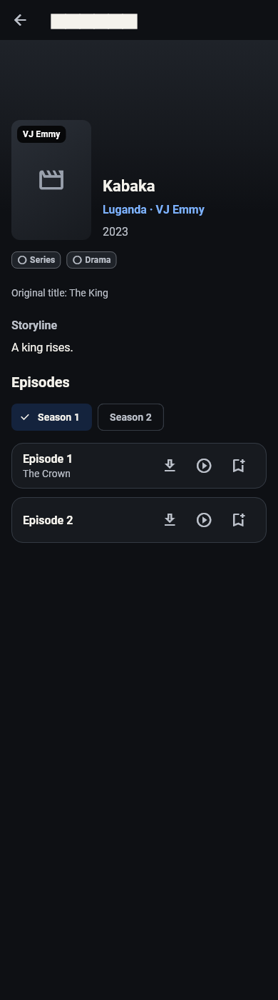
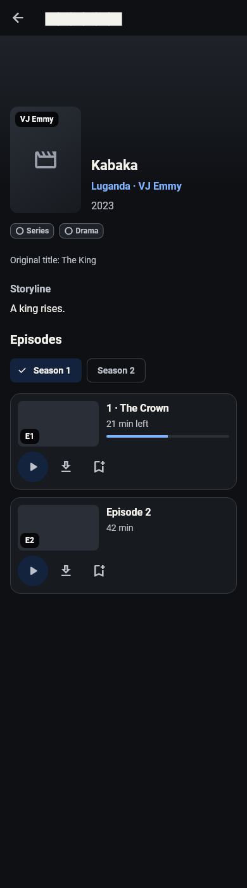
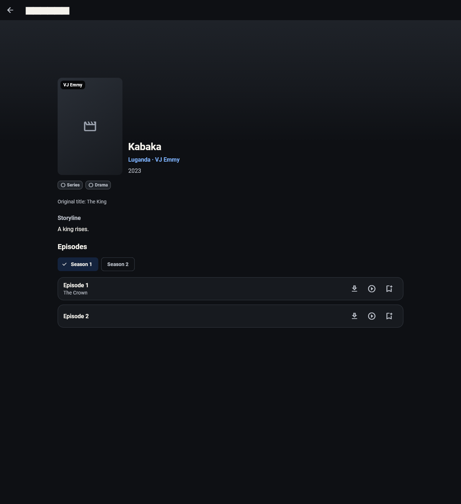
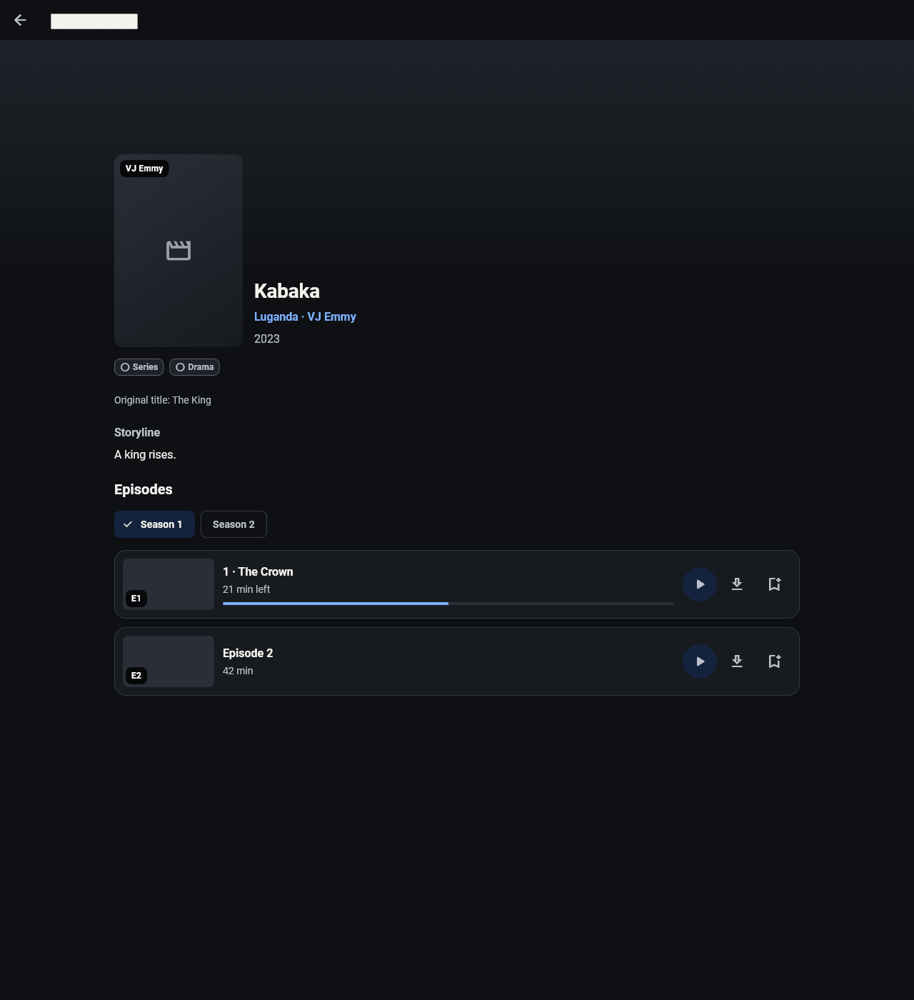
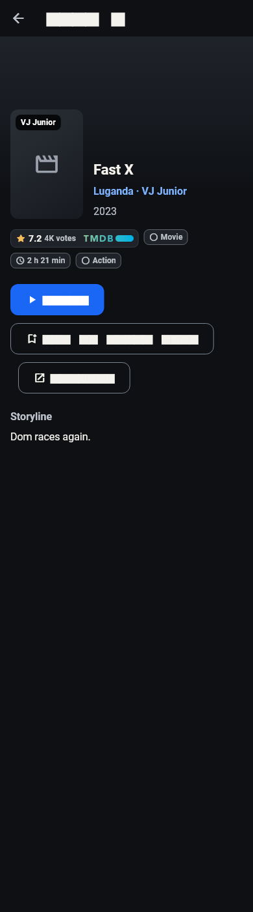
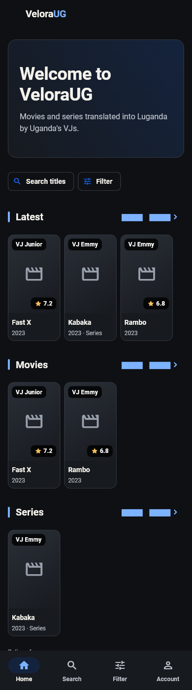
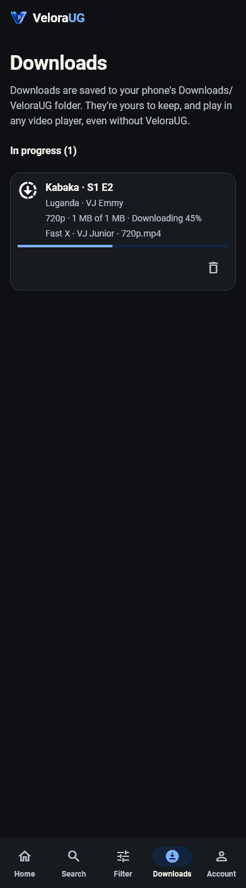
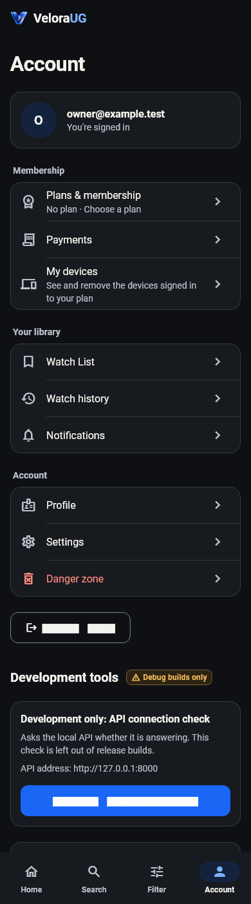

# Step 13F: Episode rows and global polish

Written and built on 25 November 2026, as Phase 6 of the UI upgrade. Built on Step 13E, which is built on 13D, 13C, 13B and 13A. **Not yet checked against a real catalogue, on a phone, or in a browser.** The screenshots come from widget tests.

## What viewers get

### Episode rows

Each episode of a series is now a row with:

- **A 16:9 thumbnail**, the series' backdrop, with the episode's number on it ("E3"). With a mouse, a play mark shows over it on hover, and a click plays. Keyboards and screen readers use the Play button instead.
- **"3 · The Crown"**, or "Episode 3" when the episode has no name.
- **Its running time**, such as "42 min", from the video's own length. Once started: "21 min left". Once finished: "Watched".
- **A progress bar** showing how far the viewer got, signed in only. It's read out as "50% watched".
- **Play, Download and Watch List**, in that order, each a 48-by-48 target with a tooltip and a screen-reader label such as "Play season 1, episode 3". On a phone, or with large text, they sit under the text so they never squeeze the title. On a wide screen they're at the end of the row.

### Download states

The episode button and the movie page's Download button share one set of looks.

| State | Looks like | Tooltip and label | A tap |
| --- | --- | --- | --- |
| Not downloaded | Download arrow | "Download season 1, episode 3" | Choose a quality |
| Queued | Clock | "…: Waiting to download" | Opens Downloads |
| Downloading | A ring filling with its progress | "…: Downloading 45%" | Opens Downloads |
| Paused | The ring with a pause mark | "…: Waiting for a connection", or Android's other reasons | Opens Downloads |
| Downloaded | Tick, in the success colour | "…: Downloaded" | Plays the file |
| Failed | Warning mark, in the danger colour | "…: Download failed. Tap to try again" | Choose a quality again |

On the web, the browser saves the file itself and the app can't follow it, so the button only ever shows "not downloaded". That's unchanged.

### Across the app

- **One page transition everywhere:** pages fade forwards, as Android's own transition does, on Android, iOS, web and desktop alike. With reduced motion, a page simply appears.
- **Large text:** page headings grow with the viewer's text size up to 1.5 times and then stop, so "Plans & membership" no longer breaks mid-word on a phone. All other text keeps growing.
- **Loading a title:** its page shows a skeleton the shape of the page instead of a lone spinner. The video's loading spinner is the shared one too.
- **Tokens instead of raw values:**
  - the edition header's shading
  - the poster chip's black and white
  - the video's background and its white text
  - the progress ring's size and stroke
  - every icon and spinner size in the viewer screens
  - the one-pixel dividers

## Decisions

The owner approved these in the plan.

| # | Decision | Why |
| --- | --- | --- |
| 1 | The thumbnail is the series' backdrop, with the episode's number | Nothing stores or fetches a picture of each episode. Fetching TMDB's season data needs a new table and its own copy rules. The catch: every row of a series shows the same picture |
| 2 | Running times come from the uploaded video's length | More accurate than TMDB's figure, which is often missing for episodes. Migration `0014` lets the API's role read that one column |
| 3 | Progress comes from a new signed-in route reading the viewer's own history | One request for the whole series. Signed out, no bars |
| 4 | Headings stop growing at 1.5 times | A long word in a 32-pixel heading can't fit a phone at twice the size. Body text keeps growing to the viewer's full size |
| 5 | Pages fade forwards on every platform | Before, Android, iOS, web and desktop each animated differently |

## What changed

| Part | Change |
| --- | --- |
| Migration `0014` | `grant select (duration_seconds) on media_originals to veloraug_app`. Nothing else |
| `app/viewer.py`, `viewer_routes.py` | Each episode has `runtime_minutes`: the ready video's length, rounded up |
| `app/account.py`, `account_routes.py` | `GET /api/v1/me/editions/{id}/progress`: `[{item_id, position_seconds, finished}]` for what the viewer played in that edition. Signed in only; reads their own history |
| `scripts/check_database.py` | The API's role may now read an original's duration, as well as its ID, item and state |
| `lib/widgets/episode_row.dart` | `EpisodeRow` |
| `lib/screens/edition_screen.dart` | The episode rows, progress loaded once signed in, and `EditionSkeleton` |
| `lib/downloads/download_ui.dart` | `downloadIcon`, shared by `DownloadButton` and `EpisodeDownloadButton`; a failed download says "Tap to try again" |
| `lib/widgets/velora_button.dart` | An optional `leading` picture, so the movie's button can show the ring |
| `lib/theme/velora_theme.dart` | `VeloraPageTransitionsBuilder` on every platform |
| `lib/widgets/screen_body.dart` | The heading's text size cap |
| `lib/api/catalogue_api.dart`, `account_api.dart` | `Episode.runtimeMinutes`, `WatchProgress` and `progress()` |
| Tokens | Colours `chip`, `onChip`, `scrimLight`, `scrimHeavy` and `video`. Sizes `backdropAspectRatio`, `episodeThumbWidth` (128), `progressBarHeight` (4), `progressRingSize` (24), `maxHeadingTextScale` (1.5), and the icon scale `VeloraIconSizes` (14 to 40). All in `tokens.dart`, `tokens.css` and `design-system.md`, checked by `theme_tokens_test.dart` |
| Strings | All in `app_en.arb` |

Left as they are, on purpose: the brand mark's size on the lock screen, the VJ page's large avatar, the TMDB logo's height, and the admin screens, which are outside this phase.

## Screenshots

Rendered by widget tests with test titles, 390 pixels wide unless marked. Tests can't load network images, so posters and thumbnails are placeholders. White blocks are labels the test renderer has no font for. The viewer in these has watched half of episode 1.

| | Before | After |
| --- | --- | --- |
| A series' page |  |  |
| A series' page, 1280 pixels |  |  |
| A movie's page |  |  |
| Home |  |  |
| Downloads |  |  |
| Account |  |  |

Home, Downloads and Account look almost the same: their changes are tokens, icon sizes and the page transition, which a still picture doesn't show.

## How to test it

1. Run migration `0014` on a test branch, then deploy the API.
2. Open a series whose episodes have finished converting. Each row shows its running time.
3. Signed in, play part of an episode, then go back to the series. Its row shows a bar and "… min left". Play one to the end: "Watched".
4. On Android, download an episode and watch its button go from the clock to a filling ring to a tick. Turn the network off part way: the ring shows a pause mark.
5. Turn on the system's reduce-motion setting: pages appear without fading.
6. Set the phone's text to its largest: page headings stay whole.

## Checks done

- **API:** 762 passed, 1 skipped, on a local Postgres 17, with `ruff` clean. `tests/test_progress.py` covers:
  - running times, rounded up, and none before a video is measured
  - the API's role reading a duration but not other columns
  - progress listing only this viewer's played items in this edition, finished ones included, without another viewer's or another edition's
  - a grant with nothing played isn't progress
  - sign-in required

  `test_uploads.py` now names the updated database check. `test_downloads.py::test_a_download_grant_ends_with_the_pass` failed once in a full run and passed on every rerun: it allows 60 seconds between the grant and its check, which a slow machine can exceed. Nothing in this phase touches downloads.
- **App:** 675 tests pass and `flutter analyze` is clean.
  - `test/episode_row_test.dart` (17 tests): the row's text and running time; progress, time left and Watched; no request when signed out; a failed progress load; the thumbnail playing; 48-by-48 buttons in order; 320 pixels at text sizes 1 and 2; each download state's look, label and tap; the movie button; and a row without a running time
  - `test/accessibility_test.dart` (7 tests): Flutter's tap-target, label and contrast checks on Home, Search, Filter, Account, a movie's page, a series' page and Downloads, on a phone and a wide screen; and Tab moving through Play, Download and Watch List, then the next episode
  - `test/polish_test.dart` (5 tests): one transition on every platform; a fade, or none with reduced motion; and the heading cap at text sizes 1 and 2
  - Updated: `viewer_screens_test.dart` now expects "1 · The Crown"
- **Auth pages:** 22 pass.

## Deploying

Run migration `0014`, then deploy the API, then the app. An older API sends no running times and answers 404 for progress; the app then shows rows without times or bars.

## Follow-ups

- Real pictures of each episode, from TMDB's season data, with a table and copy rules like the films'.
- The Watch List button's label names the episode for screen readers ("Add season 1, episode 3 to Watch List"). Today every row's says "Add to Watch List".
- `test_a_download_grant_ends_with_the_pass` could allow more time, so a slow machine doesn't fail it.
