# Step 13G: The sign-in pages, logo fix and redesign

Written and built on 25 November 2026, as Phase 7, the last phase of the UI upgrade. Built on Step 13F. **Not yet deployed or checked against Neon, or on a real phone.** The screenshots come from headless Chrome against the local development server, pointed at an address that doesn't answer, so the Sign in page shows its "couldn't reach the sign-in service" message.

**Visual changes only.** `src/auth.js`, `src/messages.js` and `src/returnTarget.js` are unchanged. In `src/App.jsx`, every call to Neon, every address, every redirect and every sentence is as it was. A test lists them.

## The logo bug

The header drew an old two-stroke "V" in the page code. It now shows the app's own mark, `apps/client/assets/brand/velora_mark.png`, shrunk to 48 pixels (`public/brand/velora-mark-48.png`, 4 KB) with a 96-pixel copy for sharp screens (13 KB). The original is 512 pixels and 212 KB, too heavy for a sign-in page. There's no SVG of the mark: the artwork is a picture, so an SVG would have to be redrawn by a designer.

The page now has the app's **favicon**, its **home-screen icon** and the brand's **theme colour**. It had none before. There's no social-preview image, by decision: the pages are hidden from search engines and only ever opened from the app.

## The redesign

| Part | Now |
| --- | --- |
| Backdrop | A still, full-screen collage of tilted poster tiles, darkened through the scrim colours into the page's colour, so the card always reads. It never moves |
| Card | Centred, solid `surface`, at most 420 pixels wide, with the raised shadow, the mark and "VeloraUG" at its top, and a larger heading |
| Fields | The label sits inside the field and floats up once it has a value, has focus, or the browser has filled it in. Fields are taller and roomier |
| Password | A Show password toggle, a 48-pixel target, whose name stays "Show password" and whose on or off is read out. Its tooltip says Show or Hide |
| Errors | A short hint shows under a field the browser finds invalid, such as an empty or badly formed email, once the person has interacted with it. The field names the hint for screen readers. Messages from the server stay under the button, as before |
| Links | Create an account, Forgot password and Back to sign in are quieter than the button: bold, with no underline until hovered |
| Footer | "VeloraUG · Movies and series translated into Luganda by Uganda's VJs" |
| Motion | The card fades in and rises 8 pixels once, over 200 ms. Nothing with reduced motion |
| Very narrow pages | Under 300 CSS pixels, as on a phone zoomed to 200%, labels sit above their fields and wrap, and Show password goes under its field, so "Password, at least 8 characters" is never cut off or hidden behind the button. The wordmark can wrap under the mark |

### The backdrop's artwork

As decided, the collage uses pictures stored with the site, never loaded from elsewhere, so the Content-Security-Policy is unchanged and the page doesn't depend on the API. **Until there's artwork, brand-coloured tiles stand in**, as in the screenshots.

To add posters:

1. Choose 6 to 8 posters VeloraUG has the rights to, such as VJs' own uploads.
2. Make each about 240 pixels wide, as WebP, around 30 KB.
3. Put them in `apps/auth_pages/public/backdrop/`.
4. List them in `apps/auth_pages/src/backdrop.js`, for example `['/backdrop/one.webp', '/backdrop/two.webp']`.

A test checks that each listed file exists and comes from this site.

## Screenshots

| | Before | After |
| --- | --- | --- |
| Sign in, phone | 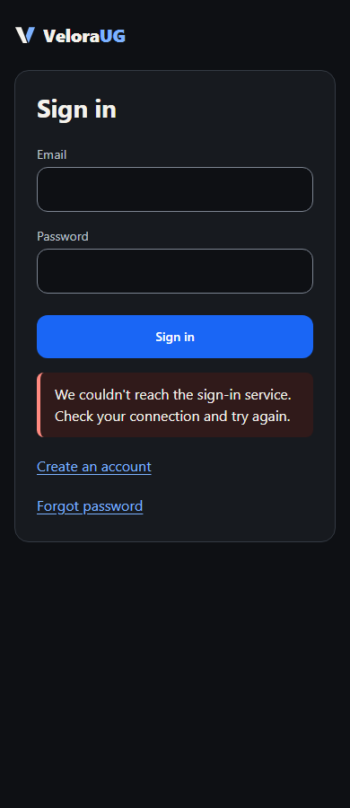 | 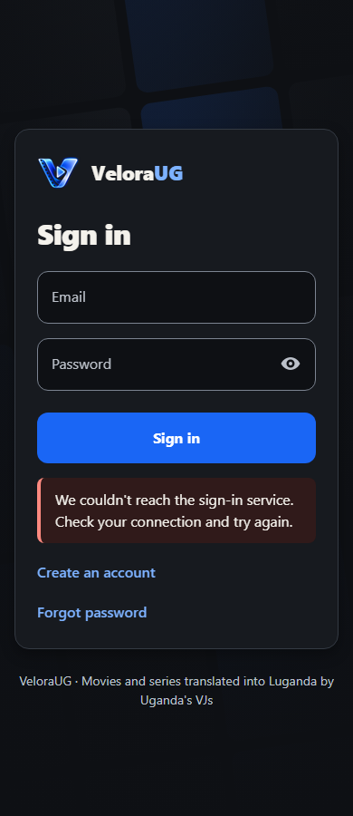 |
| Sign in, wide | 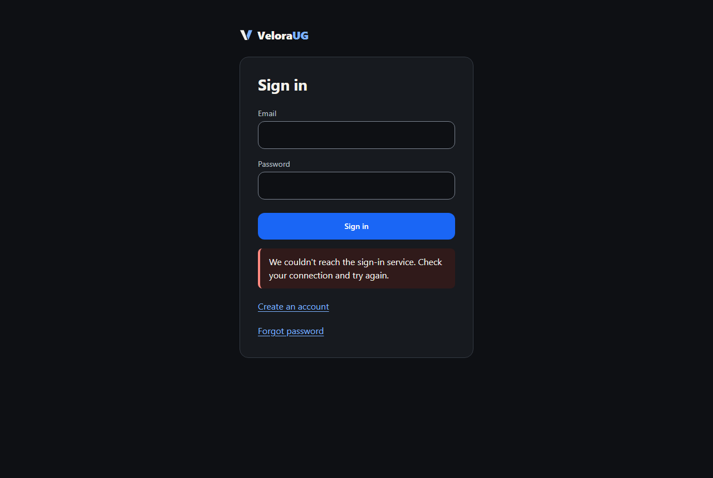 | 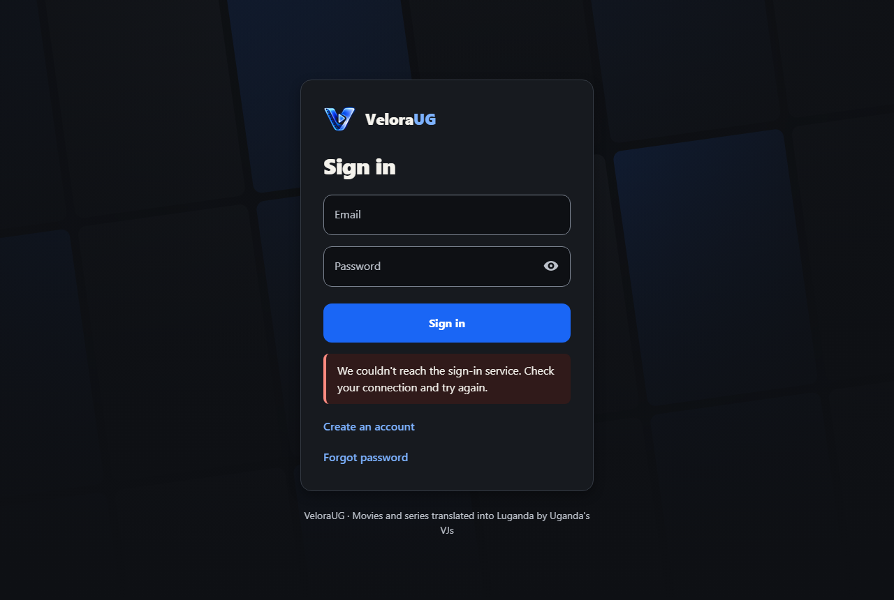 |
| Create an account, phone | 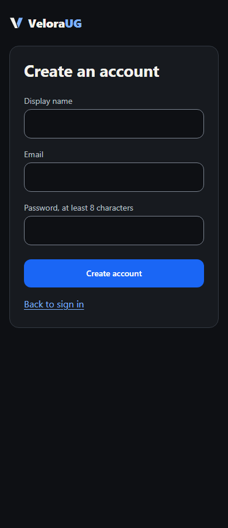 | 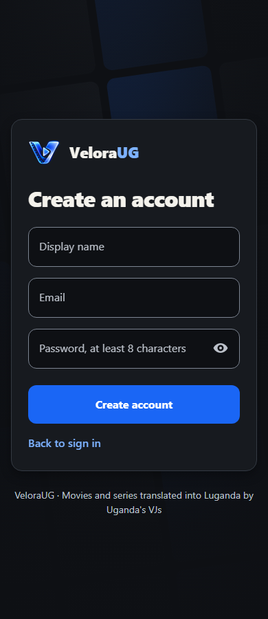 |
| Create an account, wide | 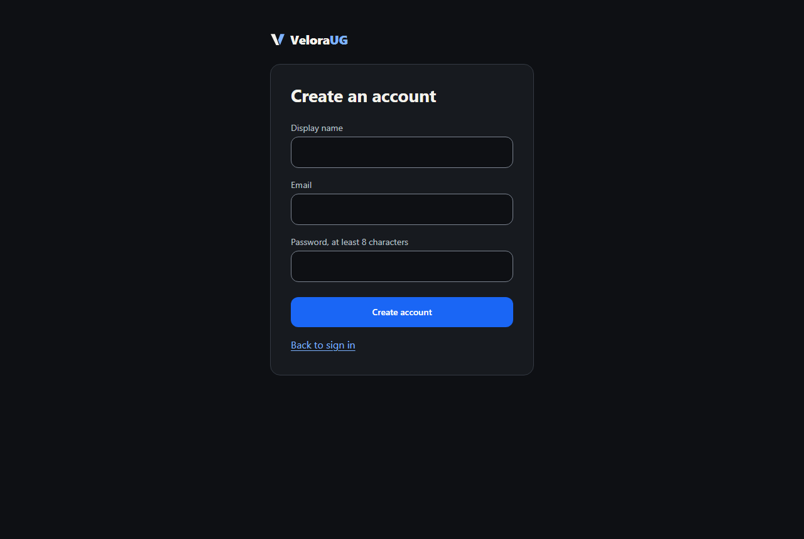 | 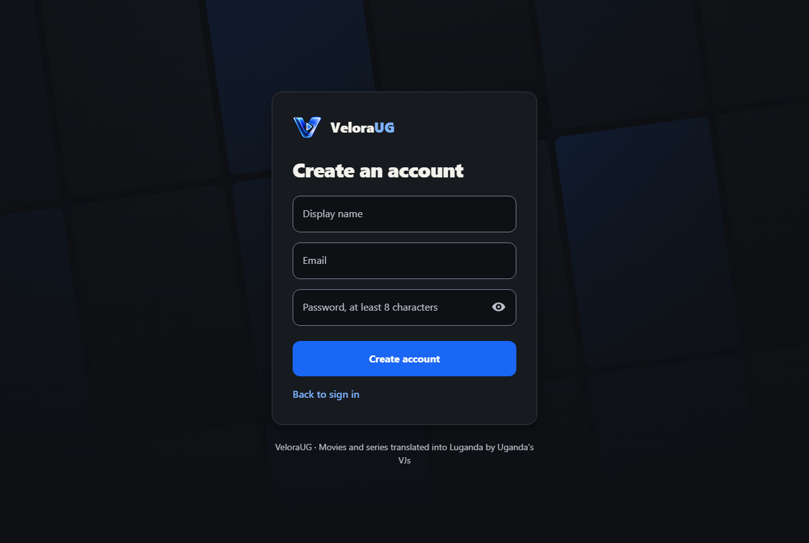 |
| Forgot password, phone | 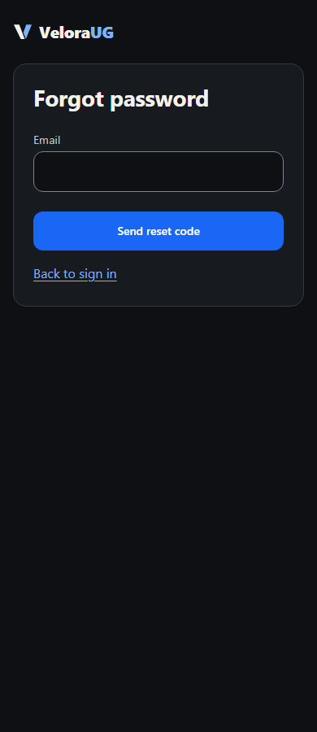 | 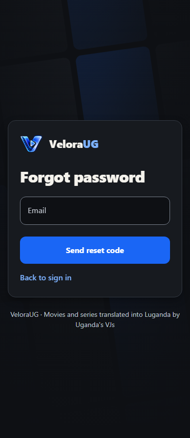 |
| Timed out, wide | 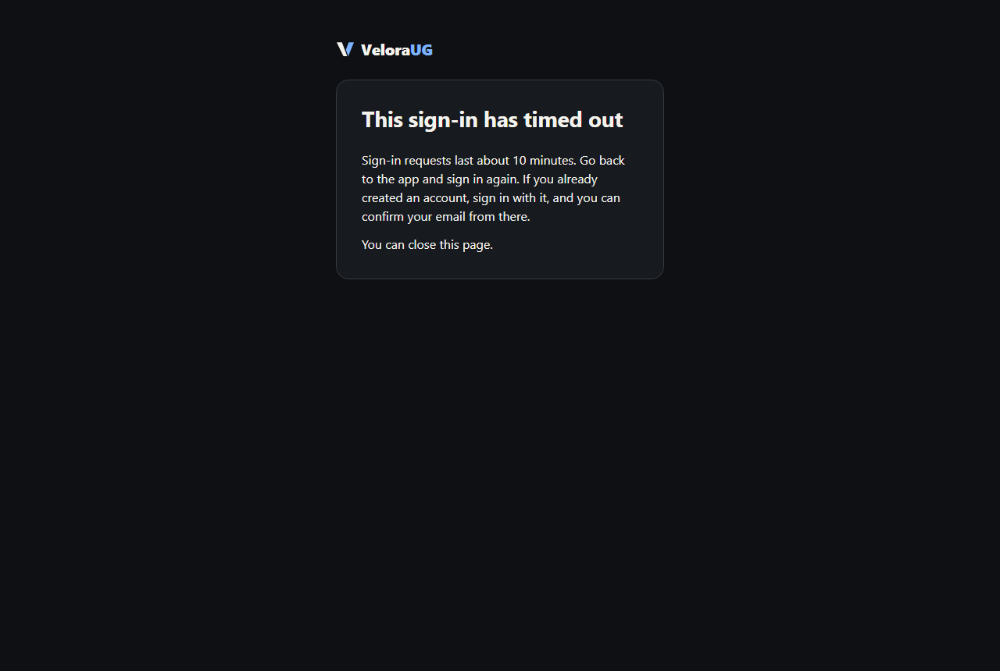 | 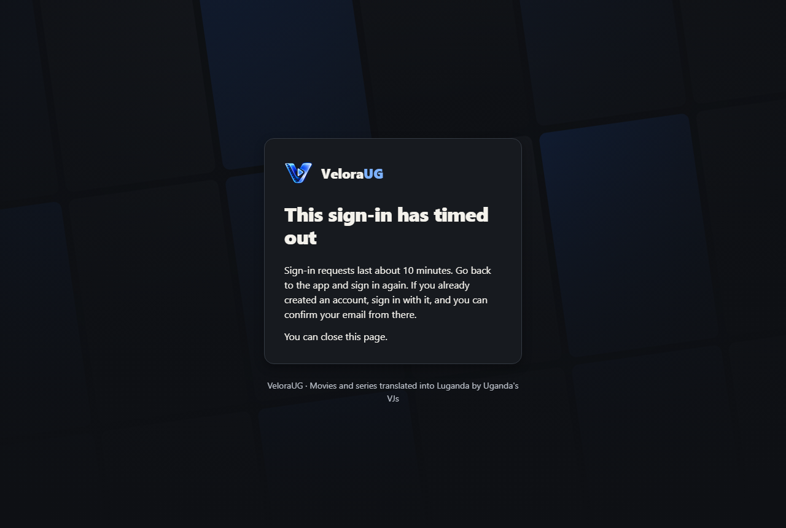 |
| Create an account, phone at 200% | | 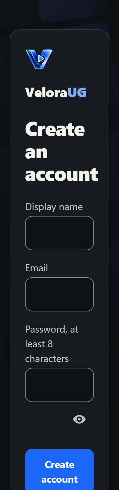 |

The other sizes are in [`step-13g/`](step-13g/).

## What changed

| File | Change |
| --- | --- |
| `src/App.jsx` | The header shows the mark image. A `Field` wraps each input with its floating label and hint; `PasswordField` adds the toggle. `Backdrop` and the footer frame the card. No logic changed |
| `src/style.css` | The redesign, with colours and sizes from tokens only |
| `src/backdrop.js` | The list of backdrop posters, empty for now |
| `index.html` | The favicon, home-screen icon and theme colour |
| `public/brand/` | The mark at 48 and 96 pixels, made from the app's, and the app's favicon and home-screen icon |
| `src/tokens.css`, `tokens.dart`, `design-system.md` | `brandMarkSize` (48), `--velora-poster-aspect` (2 / 3) and `--velora-shadow-raised`, which mirrors `VeloraShadows.raised`. The design system describes the new sign-in layout |
| `test/pages.test.js`, `test/render.jsx` | New tests. The pages are rendered on the server through Vite, with no new dependency |
| `test/tokens.test.js` | Contrast for field labels on the field's fill, the footer, and a hint on the card |

## How to test it

1. `npm test` in `apps/auth_pages`.
2. `npm run dev`, then open the app and start signing in, so Neon sends a signed request to the local pages.
3. Type an email and a password: each label floats up. Tab out of an empty email: its hint appears. Press the eye: the password shows, and pressing again hides it.
4. Zoom the browser to 200% on a narrow window: labels sit above their fields, and nothing is cut off.
5. Turn on reduced motion: the card appears without fading.
6. Sign in, create an account, reset a password and allow access, as in the [Step 5C report](step-05c-report.md). Each should work exactly as before.

## Checks done

- **Sign-in pages:** 32 tests pass, with 10 new.
  - **New in `test/pages.test.js`:**
    - the old drawn mark is gone, and the mark images are 48 and 96 pixels
    - `index.html` links the icons and the theme colour, and the files exist
    - the Content-Security-Policy is unchanged
    - backdrop pictures come only from this site
    - every Neon call, address and sentence is still in `App.jsx`
  - **Rendered checks:**
    - each field has its own label and the hint it names
    - a password starts hidden, with a Show password toggle that doesn't submit the form
    - the card has its mark, backdrop and footer
    - a timed-out request still shows the timed-out page
    - a page without a signed request says to start from the app
- **Build:** `npm run build` succeeds.
- **Rendering in a browser:** checked in headless Chrome:
  - each page, on a phone and a wide screen
  - a floated label, a hint and the toggle switched on
  - a phone at 200% zoom
- **App:** 675 tests pass and `flutter analyze` is clean, with the new token checked by `theme_tokens_test.dart`.
- **API:** unchanged in this phase.

## Deploying

Build and deploy the sign-in pages as before: `npm run build` for development, `npm run build:prod` for production. Nothing else needs to change.

## Follow-ups

- Real posters for the backdrop, as above.
- An SVG of the mark, if a designer redraws it, would be sharper at every size and smaller still.
- The pages' wording isn't translated: it has always been English only, in `App.jsx` and `messages.js`.
